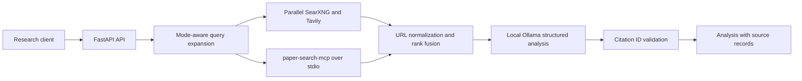

<<<<<<< HEAD
# Research Search Agent

An API-first research assistant for project novelty screening, scholarly literature discovery, and patent landscape triage. It searches an existing SearXNG instance and optionally Tavily in parallel, uses [`paper-search-mcp`](https://github.com/openags/paper-search-mcp) for federated academic discovery, fuses duplicate records, and asks a local Ollama model to produce a structured analysis tied to retrieved source IDs.

It also launches paper-search-mcp as a local stdio MCP server for federated academic paper search. This is a screening aid, not a legal novelty, patentability, infringement, or freedom-to-operate opinion. Search coverage is incomplete; conclusions need primary-source review and, for legal questions, qualified counsel.

## Architecture



SearXNG is required. If you already run it, keep that instance and set its host-published endpoint. Otherwise, `docker-compose.searxng.yml` starts a loopback-only SearXNG service with JSON output enabled. Tavily is optional; without `TAVILY_API_KEY`, the app omits Tavily. Paper search runs in a supervised local stdio child process by default; set `PAPER_MCP_ENABLED=false` to disable it. Ollama remains your existing local inference service.

## Files

- `app/config.py`: validated settings from environment and `.env`.
- `app/models.py`: request, source, health, and response contracts.
- `app/search.py`: query expansion, provider calls, partial failure handling, URL normalization, and reciprocal-rank fusion.
- `app/papers.py`: MCP stdio lifecycle, unified academic search, and paper-record normalization.
- `app/analysis.py`: Ollama structured output schema, untrusted-source prompting, and citation ID validation.
- `app/main.py`: health, search, and research API endpoints, optional bearer auth, concurrency bound, and CORS.
- `tests/`: unit tests for URL fusion and citation validation.
- `Dockerfile`, `docker-compose.agent.yml`: hardened agent container; Docker reaches host-published SearXNG and Ollama through `host.docker.internal`.
- `docker-compose.searxng.yml`, `searxng/settings.yml`: optional local SearXNG service, bound to loopback with JSON API enabled.

## Setup

### Start SearXNG when you do not already have it

The SearXNG service is separate from the agent and is published only on `127.0.0.1:8080`. It enables the JSON format required by the agent. The mounted settings and search cache persist across container restarts. For any non-local deployment, pin `SEARXNG_VERSION` to a reviewed release, replace the development secret with a generated random `SEARXNG_SECRET` in `.env`, and configure authentication and TLS at a reverse proxy. SearXNG documents Compose as its recommended container deployment and requires JSON to be enabled under `search.formats` for JSON API requests ([container setup](https://docs.searxng.org/admin/installation-docker), [search API](https://docs.searxng.org/dev/search_api.html)).

```powershell
docker compose -f docker-compose.searxng.yml up -d
curl.exe "http://localhost:8080/search?q=health&format=json"
```

For the agent running locally in PowerShell, set `SEARXNG_URL=http://localhost:8080` in `.env`. The Docker agent Compose file overrides this to `http://host.docker.internal:8080` so the agent container can reach SearXNG on the Windows host.

### Existing services on the host

From this directory in PowerShell:

```powershell
Copy-Item .env.example .env
notepad .env
```

Set `OLLAMA_MODEL` to an installed model. Pull one if needed, for example `ollama pull qwen2.5:14b`. Confirm existing endpoints are reachable and set `SEARXNG_URL` and `OLLAMA_URL` accordingly. SearXNG must permit the JSON response format (`search.formats` includes `json`); SearXNG returns 403 if a format is disabled. The editable install brings in the MCP SDK and pinned paper-search package; its broad source set is narrowed to OpenAlex, Crossref, arXiv, PubMed, and Europe PMC.

Run locally:

```powershell
py -3.12 -m venv .venv
.\.venv\Scripts\Activate.ps1
python -m pip install -e '.[dev]'
uvicorn app.main:app --reload
```

### Run the agent in Docker

The agent Compose file uses `host.docker.internal` for SearXNG and Ollama services published on the Windows host. If your SearXNG and Ollama containers share a user-defined Docker network with this agent, replace those two environment values with their Docker DNS names and attach the agent to that network.

```powershell
Copy-Item .env.example .env
docker compose -f docker-compose.agent.yml up --build -d
docker compose -f docker-compose.agent.yml logs -f research-agent
```

Optionally set a long random `AGENT_API_KEY` before exposing the service beyond loopback. Keep `.env` out of version control. Restrict `ALLOWED_ORIGINS` to the actual browser client origins.

## API

`POST /v1/search` returns ranked source records. `POST /v1/research` returns an analysis plus the complete source list. Both accept:

```json
{
  "query": "Does a low-cost acoustic sensor network detect crop disease earlier than existing approaches?",
  "mode": "novelty",
  "max_results": 10,
  "language": "en"
}
```

Modes: `novelty`, `papers`, `patents`. Academic MCP discovery runs for `novelty` and `papers` through its unified `search_papers` tool; those records merge with web results. Each source has a stable ID derived from its URL; analysis claims refer to those IDs. Unknown IDs returned by the model are discarded. The response includes provider states and elapsed time. `/health` reports SearXNG, Ollama, Tavily configuration, and MCP connectivity.

```powershell
$body = @{ query = 'wireless acoustic crop disease early detection'; mode = 'novelty'; max_results = 10 } | ConvertTo-Json
Invoke-RestMethod http://localhost:8000/v1/research -Method Post -ContentType 'application/json' -Body $body
```

When `AGENT_API_KEY` is set, pass `Authorization: Bearer <key>` on `/v1/search` and `/v1/research` requests. Health remains available for container monitoring.

## Tests

```powershell
python -m pip install -e '.[dev]'
pytest
ruff check app tests
```

Tests use no live providers; they cover canonical URL deduplication, source fusion, paper record normalization, request mode validation, and filtering citations to retrieved sources. Add integration tests against disposable/mock HTTP and MCP endpoints before production rollout.

## Production notes

- Use TLS and an authenticated reverse proxy or enable `AGENT_API_KEY`; keep the service bound to loopback unless access control is in place.
- Set client timeouts and concurrency from the capacity of the existing services. Tavily requests use credits, so hybrid mode performs multiple Tavily searches per analysis; omit the key for SearXNG-only use or reduce query variants in `app/search.py`.
- Paper and patent modes request Tavily raw page content, then cap each stored snippet before it reaches Ollama; verify API plan costs and source terms before scaling.
- Optional paper-search source API keys can be forwarded through `PAPER_SEARCH_MCP_*` environment variables; unrelated application secrets are not passed to its subprocess. Google Scholar may be rate-limited while other academic sources still return records.
- Add persistent caching, request-level rate limits, structured access logs, metrics, and a durable audit store before multi-user deployment. This starter intentionally does not persist potentially sensitive project descriptions.
- For patent work, independently verify bibliographic data, publication and priority dates, family members, prosecution/legal status, jurisdiction, and claim language in official patent registries. A web result snippet cannot establish legal status or freedom to operate.
- Treat retrieved pages as hostile input. The model is instructed not to follow page instructions; source IDs are validated, but claim text still requires human review.

## Provider references

- [SearXNG Search API](https://docs.searxng.org/dev/search_api.html): JSON output uses `format=json`; the format must be enabled under `search.formats` or the instance returns 403.
- [Tavily Search API](https://docs.tavily.com/documentation/api-reference/endpoint/search): authenticated POST to `/search`.
- [paper-search-mcp](https://github.com/openags/paper-search-mcp): stdio MCP server and unified `search_papers` tool.
- [Ollama Chat API](https://docs.ollama.com/api/chat): local `/api/chat`, non-streaming response, structured outputs.
- [Ollama API introduction](https://docs.ollama.com/api/introduction): local server endpoint and client usage.
=======
# search-engine
>>>>>>> ba7abf3ce8cdb0832e48725f29ee4fefbefd82e9
